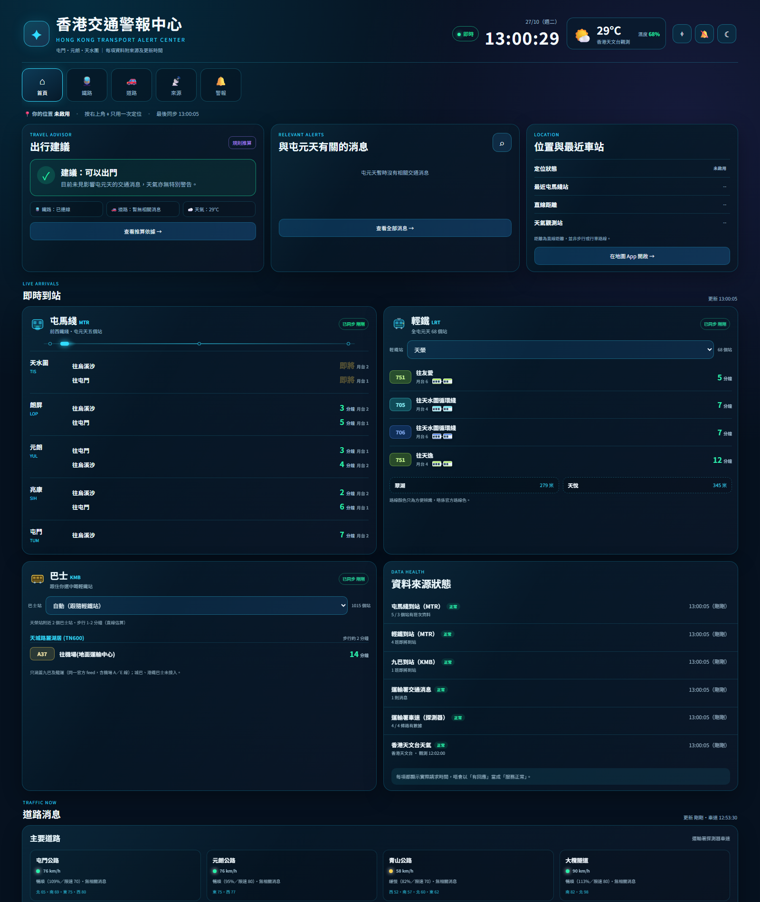
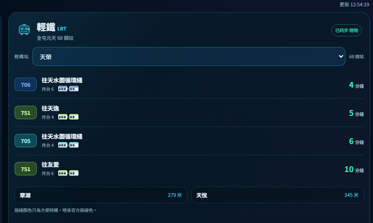
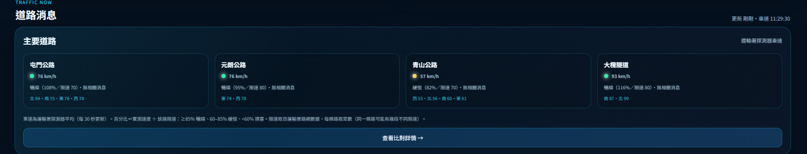

# 香港交通警報中心 v2｜資料可追溯版

屯門、元朗、天水圍的即時交通面板：屯馬綫到站、輕鐵到站、運輸署道路消息、香港天文台天氣。

**這個版本唯一的設計目標是「講真話」**：每一格資料都標明來源同更新時間，冇消息就講冇消息，唔會用「大致暢順」或「系統正常」蓋過去。



---

## 與 v1 的分別

| 項目 | v1 | v2 |
|---|---|---|
| 程式結構 | 一個 24KB `app.js`，全部狀態散在 `window` | 35 個模組，單一 store + 明確 slice |
| 建置 | 冇，手動改 `?v=ultimate11-multi` | Vite + TypeScript strict，hash 檔名 |
| 型別安全 | 冇 | `tsc --noEmit` 零錯誤，API 回應逐層驗證 |
| 測試 | 冇 | `node --test`，27 個單元測試（嚴重程度、路名比對、建議規則、時間格式） |
| DOM 寫法 | `innerHTML` + `esc()`，漏一個就 XSS | 全 `createElement`／`textContent`，資料不可能變成 HTML |
| 請求節奏 | 3 個 `setInterval`，背景照跑、失敗照跑 | 單一排程器，可見性暫停、離線停手、指數退避、abort |
| 到站請求 | 每 10 秒 6 個請求 | 每 30 秒 1 個聚合請求（Worker 端並行）→ 上游請求 −90% |
| 快取 | 冇 | Worker 邊緣快取（到站 10s／天氣 60s／交通 45s），全港共用 |
| 假數據 | 假行程時間、假地圖、假「系統正常」 | 全部移除 |
| 解封消息 | 當成新警報彈出 | 識別「現已解封」，降為一般消息、不觸發警報 |
| 天氣 | 用 icon code 猜天氣、忽略警告 | 顯示真正的 `warningMessage`（暴雨／颱風警告） |
| 離線 | 白畫面 | Service Worker 導航 network-first + 靜態資源 cache-first |
| PWA | 只有 192 icon，冇 512、冇 maskable | 192 / 512 / maskable / SVG，可用「加到主畫面」 |

---

## 輕鐵面板為什麼要重構

v1 的輕鐵區是「一個平面清單」：三個站的班次混在一起，每行都要寫一次「天榮 → 天水圍循環綫」，8 行裡面有 3 行都是同一條 507。實際上你站在月台，只關心**一個站**。

所以改成三層結構：

1. **以站分頁**：`天榮 / 屯門 / 兆禧` 三個 tab，每個 tab 直接顯示「下一班幾分鐘」，唔需要逐行搵。
2. **行內只講一次**：因為 tab 已經講了站名，行裡面只保留「路線・目的地・月台・分鐘」。
3. **其他站一眼掃到**：底部兩張半透明卡顯示另外兩個站的下一班，一按即切換。
4. **單卡／雙卡用圖示**：直接讀官方 `train_length`（1 = 單卡、2 = 雙卡），畫一節或兩節車廂。
   資料缺失時**唔顯示圖示**，唔會預設當單卡——寧願冇，都唔好報錯。

配合的視覺：

- 路線號有固定色相（由路線號推導，純粹方便分辨，**唔係官方路線色**，UI 有寫明）
- 「即將」用黃色 + 呼吸動畫，3 分鐘以上用綠色
- 輕鐵用會輕輕上下擺動的電車圖示，屯馬綫用列車圖示 + 一條會行車的迷你路綫圖（三個站點 + 一粒光由左行到右）



全部動畫都用 CSS，跟隨系統 `prefers-reduced-motion` 自動停用；圖示只掛一次，唔會每 30 秒重繪時由頭跳一次。

---

## v2.1 介面精簡

按「是否重複」逐項刪，唔係為咗簡潔而簡潔：

| 移除 | 原因 |
|---|---|
| 「所在地天氣」面板 | 頁首已經有溫度、濕度、圖示，同一組數字出現兩次只係噪音。唯一保留的補充是**生效中警告**——它不重複溫度，而且比溫度重要，所以做成頁首一粒可點標籤。 |
| 「路網示意」 | 本身是裝飾性 `div`，不是真地圖、也不是真路況。留著只會令人以為係實時路況；要真地圖就直接開裝置地圖 App。 |
| 「附近及快捷工具」 | 八個按鈕全部只是「開 Google Maps 搜尋」，裝置地圖本身做得好得多。 |
| 「智能語音助手」 | 依賴裝置的 TTS 聲音，質素參差，而且要手動開；實際使用率低。 |

結果：頁面少 4 個區塊，JS gzip 17.5KB → 16.3KB，HTML gzip 4.0KB → 3.2KB。



---

## v2.2：GPS 自動選站、九巴到站、Web Push

### 1. GPS 自動選站

按頁首 `⌖` 定位後，用真實座標計出最近嘅輕鐵站（3 公里內才切換），同時帶動巴士面板。

座標來源：OpenStreetMap `railway=station`，用 `ref`（即輕鐵站號 500／295／240）配對——唔用站名，因為「屯門」同時有西鐵站同輕鐵站。三個座標同選站邏輯都有測試固定（`test/places.test.ts`），例如屯門碼頭座標必須選到「兆禧」。

### 2. 九巴到站

每個輕鐵站配 **2-3 個最近而有路線停靠** 嘅九巴站（由九巴公開嘅 6,774 個站，用直線距離篩選，並記錄實際距離）。面板顯示路線、目的地、上車站編號、到站分鐘；前端只發 **1 個** `/api/bus` 請求，Worker 端並行打九巴。


只涵蓋九巴及龍運（同一官方 feed，機場 A／E 線都在內）；城巴、港鐵巴士未接入——面板底部有寫明。

### 3. Web Push（真背景推送）

Worker 每 5 分鐘抓一次運輸署消息，同 KV 內「上次見過的 ID」比對，有新而相關（屯元天）就推送：

- 「現已解封」**唔會**推送（好消息唔應該嘈醒你）
- 訂閱失效（404／410）自動由 KV 刪除
- VAPID 用 ES256，payload 用 RFC 8291 `aes128gcm`

前端通知按鈕有三態：已訂閱 🔔／未設定（退回頁面內通知）／被封鎖。

**部署（需要一次性設定）：**

```bash
cd worker
npx wrangler kv namespace create SUBSCRIPTIONS   # 把回傳 id 貼落 wrangler.toml
# 產生 VAPID 金鑰（publicKey 必須是 65-byte 未壓縮 P-256 點，base64url）
npx web-push generate-vapid-keys
npx wrangler secret put VAPID_PUBLIC_KEY
npx wrangler secret put VAPID_PRIVATE_KEY
npx wrangler secret put VAPID_SUBJECT          # mailto:you@example.com
npx wrangler deploy
```

未設定 VAPID／KV 時，`/api/push/key` 回 503，前端會如實顯示「伺服器未設定推送」，唔會假裝成功。

**點驗證：** `test/push.test.ts` 做完整 round-trip——自己用 `encryptPayload` 加密，再用「瀏覽器私鑰」解密比對，總共 4 個測試（含 VAPID JWT 簽名驗證）。另外 `tools/worker-harness.mjs` 可以直接喺 node 跑真正嘅 Worker 程式碼：

```bash
node tools/worker-harness.mjs          # http://localhost:8799
VITE_PROXY_BASE=http://localhost:8799 pnpm build && pnpm preview
```

---

## v2.3：真實車速（取代關鍵詞猜路況）

之前「屯門公路」的狀態只代表「新聞有冇提到屯門公路」。現在改用運輸署的探測器數據：

- 原始 feed：`resource.data.one.gov.hk/td/traffic-detectors/rawSpeedVol-all.xml`（每 30 秒、807 個探測器、逐車道車速）
- 探測器位置：`static.data.gov.hk/.../traffic_speed_volume_occ_info.csv`（172KB，邊緣快取 6 小時）
- Worker 只回 4 條路的平均車速（屯門公路／元朗公路／青山公路／大欖隧道），前端唔需要 download 709KB

計算方式：**先計每個探測器的車道平均（只取 `valid=Y`），再平均所有探測器**——避免車道多嘅探測器主導結果。

**按方向分開**：同一條路東行同西行可以相差好遠（真實數據見過屯門公路北行 64、西行 78），雙方向平均會互相抵銷。所以聚合時會用位置描述的「－東行／西行／南行／北行」分組，卡片上列出各方向速度；相差超過 20% 時會標明邊個方向較慢。

限速來源：運輸署「道路網絡（第二代）－ 車速限制」KML（`SPEED_LIMIT.kmz`，4,385 段）。該 KML 只有限速同幾何、冇路名，所以用探測器座標做**最近路段空間匹配**，再取每條路嘅眾數：屯門公路 70（52/75）、元朗公路 80（33/36）、青山公路 70（16/28）、大欖隧道 80（2 個探測器各一，樣本少）。UI 會同時顯示所用限速，用戶睇得到個假設。


塞唔塞唔再用固定 km/h 判斷，而係**實測速度 ÷ 該路限速**：≥85% 暢順、60–85% 緩慢、<60% 擠塞。同樣 58 km/h，在限速 70 的青山公路算出 83%（緩慢），在限速 50 的路就會是 116%（暢順）——呢個就係固定門檻做唔到嘅事。

`test/roads.test.ts` 用固定 fixture 驗證 CSV／XML 解析同聚合（包括「青朗公路唔會被當成元朗公路」），另有 `test/speed.test.ts` 驗證分級邊界。

---
## 想改嘢？改呢幾個檔案

所有「你會想調」的東西都集中在 `src/config.ts`，其他地方只讀它。

| 想改 | 改邊個檔 |
|---|---|
| 加／減車站 | `src/config.ts` → `TML_STATIONS`（屯馬綫）、`LRT_GROUPS`（輕鐵） |
| 換附近巴士站 | `src/config.ts` → `LRT_GROUPS[].bus`（九巴 16 位站號） |
| 加減道路、改限速 | `src/config.ts` → `ROADS`（`patterns` 路名比對、`limit` km/h） |
| 調車速分級門檻 | `src/config.ts` → `SPEED_THRESHOLDS` |
| 調刷新頻率 | `src/config.ts` → `REFRESH_MS` |
| 換 Worker 位址 | `src/config.ts` → `APP.proxyBase`，或 `.env.local` 的 `VITE_PROXY_BASE`（見 `.env.example`） |
| 改地區關鍵詞 / 解封字眼 | `src/config.ts` → `DISTRICT_KEYWORDS` / `REOPENED_PATTERNS` |
| Worker 部署設定（KV、Cron、VAPID） | `worker/wrangler.toml` |
| 版面文字、結構 | `index.html`、`src/styles/extra.css` |
| 算法（建議、分級、聚合） | `src/core/*.ts`、`worker/src/roads.js` |

> ⚠️ 加屯馬綫站要**兩邊改**：`src/config.ts` 的 `TML_STATIONS`，同 `worker/src/index.js` 的 `TML_STATIONS` 白名單。輕鐵站就唔需要改 Worker。

改完跑 `pnpm check`（型別 + 47 個測試 + build）；測試會即刻話你知有冇改壞。

---
## 快速開始

需要 Node 20+（實測 Node 24）。

```bash
pnpm install
pnpm dev        # http://localhost:4173
pnpm check      # typecheck + 單元測試 + production build
pnpm build      # 輸出 dist/
pnpm preview    # 預覽 dist/
```

`pnpm test` 只跑單元測試；`pnpm build` 只建置。

### 指向自己的 Worker

預設 proxy 是 `src/api/client.ts` 內的 `FALLBACK_PROXY`。要換成自己部署的 Worker，在專案根目錄建 `.env.local`：

```
VITE_PROXY_BASE=https://<你的-worker>.workers.dev
```

---

## 部署

### 部署網站（GitHub Pages，由 `main` 的 `/docs` 提供）

本 repo 的 Pages 設定係 **Branch = `main`、Folder = `/docs`**。`docs/` 入面就係 build 出嚟的靜態檔（連 `.nojekyll`）。

更新流程：

```bash
pnpm check        # 型別 + 53 個測試 + build
pnpm deploy:docs  # build → 複製到 docs/ → commit → push main
```

約一分鐘後就會反映到 https://d-hkd.github.io/hk-traffic-super-screen/ 。

> 為什麼唔用 GitHub Actions？呢個 repo 的 Pages「Source」選單冇提供「GitHub Actions」選項（只有 branch）。用 branch + `/docs` 效果一樣，亦唔需要 Actions 權限；代價係要手動跑一次 `pnpm deploy:docs`。
### Worker（部署 + 開推送）

需要 Cloudflare 帳號（免費方案已夠）。全部指令在 `worker/` 目錄執行。

```bash
cd worker
npx wrangler login          # 只需做一次
```

**1. 建 KV（存推送訂閱）**

```bash
npx wrangler kv namespace create SUBSCRIPTIONS
```

回傳會有一個 `id`，貼落 `worker/wrangler.toml`：

```toml
[[kv_namespaces]]
binding = "SUBSCRIPTIONS"
id = "貼呢度"
```

**2. 產生 VAPID 金鑰**

```bash
node ../tools/make-vapid-keys.mjs
```

會印出兩行。逐個貼入：

```bash
npx wrangler secret put VAPID_PUBLIC_KEY     # 貼 VAPID_PUBLIC_KEY= 後面那串
npx wrangler secret put VAPID_PRIVATE_KEY    # 貼 VAPID_PRIVATE_KEY= 後面那串
npx wrangler secret put VAPID_SUBJECT        # 例如 mailto:you@example.com
```

`wrangler.toml` 的 `[vars] VAPID_SUBJECT` 可留空，secret 會蓋過。

**3. 部署**

```bash
npx wrangler deploy
```

完成後開 `https://<worker>.workers.dev/` 應該見到 `{"ok":true,...}`，並列出所有端點。

**4. 確認端點**

```bash
curl "https://<worker>.workers.dev/api/roads"
curl "https://<worker>.workers.dev/api/bus?stops=79D68EE7C6CBAB9D,D74B67D55C63895F"
curl "https://<worker>.workers.dev/api/push/key"     # 未設 VAPID 會回 503
```

**5. 前端接上新 Worker**

改了 Worker 名或想用自己 domain，就在專案根目錄建 `.env.local`：

```
VITE_PROXY_BASE=https://<worker>.workers.dev
```

然後 `pnpm build`。

> 可選：`worker/wrangler.toml` 的 `ALLOWED_ORIGINS` 可收窄來源（預設 `*`，因為全部是公開唯讀資料）。

---

## 架構

```
index.html
src/
  config.ts          ⚙️ 所有可調參數：車站、巴士站、道路、限速、門檻、刷新間隔、Proxy
  main.ts            組裝：store + scheduler + 6 個 job + 事件綁定 + 推送開關
  api/               client（逾時/abort）、mtr、lrt、bus、roads、weather、traffic、types
  core/
    store.ts         30 行 store，slice 換 reference 就代表有改動
    scheduler.ts     單一 tick loop、可見性/離線/退避/abort
    messages.ts      嚴重程度、解封判斷、路名比對、地區相關性
    advice.ts        規則式出行建議（附推算依據）
    geo.ts           天文台觀測站、最近屯馬綫站
    places.ts        輕鐵站座標（OSM ref 配對）+ 附近九巴站（零 import，可直接測試）
    speed.ts         車速分級（固定門檻，可測試）
  ui/                每個面板一個 render 函式，只讀 state 唔改 state
  lib/               dom（安全建構）、svg、format（時間/分鐘）、validate（執行期驗證）
  push.ts            Web Push 訂閱／取消（三態，未設定會如實降級）
  styles/            base.css（沿用 v1 視覺）+ extra.css（v2 追加）
worker/src/index.js  CORS proxy + /api/rail + /api/bus + /api/push/* + 邊緣快取
worker/src/roads.js  TD 車速 XML／CSV 解析 + 每路聚合（有 fixture 測試）
worker/src/push.js   VAPID JWT (ES256) + RFC 8291 aes128gcm（有 round-trip 測試）
tools/worker-harness.mjs  用 node 直接跑 Worker 程式碼（本地開發用）
public/              sw.js、manifest.webmanifest、icons
test/                47 個 node:test 單元測試（8 個檔案）
```

### 資料流

```
scheduler.tick（1 秒）
  → job.run（帶 AbortSignal）
    → api.getJson/getXml（9 秒逾時、錯誤帶 HTTPS 狀態）
      → 逐層 validate（錯就講邊一層錯）
        → store.update({ slice })
          → renderApp（只重繪有改動的 slice）
```

### 為什麼用 `Slice<T>` 包住每個資料源

```ts
interface Slice<T> {
  state: 'idle' | 'loading' | 'ok' | 'error';
  data: T | null;
  updatedAt: Date | null;
  error: string | null;
  fetchMs: number | null;
}
```

「有冇資料」同「幾時拿」同「有冇出錯」是三件獨立的事。把它們綁在同一個物件裡，UI 才有辦法分辨：

- 從未載入 → 骨架
- 有舊資料但失敗 → 顯示舊資料 + 標示「更新失敗」
- 有資料但 5 分鐘沒更新 → 標示「過時」
- 部分成功（三個站中一個失敗）→ 標示「部分」

v1 只有「有／無」，所以只能永遠顯示「載入中…」。

---

## 資料來源

| 來源 | 端點 | 邊緣快取 | 前端輪詢 |
|---|---|---|---|
| 屯馬綫到站 | `rt.data.gov.hk/v1/transport/mtr/getSchedule.php` | 10s | 30s |
| 輕鐵到站 | `rt.data.gov.hk/v1/transport/mtr/lrt/getSchedule` | 10s | 30s |
| 九巴到站 | `data.etabus.gov.hk/v1/transport/kmb/stop-eta/{stop}` | 20s | 60s |
| 運輸署交通消息 | `td.gov.hk/tc/special_news/trafficnews.xml` | 45s | 45s |
| 運輸署車速（原始） | `resource.data.one.gov.hk/td/traffic-detectors/rawSpeedVol-all.xml` | 60s | 60s |
| 探測器位置（CSV） | `static.data.gov.hk/.../traffic_speed_volume_occ_info.csv` | 6h | — |
| 香港天文台 | `data.weather.gov.hk/.../rhrread` | 60s | 120s |

全部經自家 Worker，因為政府 API 冇開 CORS。

---

## 誠實聲明（重要）

這個 app 刻意**不做**以下事情，因為做了就等於講大話：

1. **唔叫自己 AI。** 「出行建議」是明確的規則引擎（`core/advice.ts`），條件寫死在程式碼裡，而且會把「用到的條件」列出來給用戶看。不是機器學習模型。
2. **唔造假數據。** v1 那三行「返工 58 分鐘」是寫死的 HTML；已移除。
3. **唔造假路況。** 車速來自運輸署探測器實測；顏色門檻是固定值而非按限速，UI 直接寫明。冇數據就顯示「無車速數據」。
4. **唔造假系統狀態。** v1 的「● 系統正常」無論連線如何都顯示正常；現在逐個來源顯示實際請求時間。
5. **唔造假路線規劃。** v1 的 README 講 OSRM／Nominatim 路線計算，但代碼裡完全沒有；這個 README 只描述代碼真實做得到的事。
6. **推送到站係真嘅，但需要你設定。** VAPID／KV 未設定時會退回「頁面開啟時通知」，UI 明講，唔會扮有背景推送。

---

## 已知限制

- **只覆蓋屯門／元朗／天水圍**（屯馬綫 5 個站：天水圍／朗屏／元朗／兆康／屯門；輕鐵 5 個站：天榮／屯門／兆禧／元朗／兆康；九巴 15 個站）。標題沒有寫「全港」。
- **車速門檻是固定值**（≥50／30–49／<30），唔係按各路限速計算；只覆蓋 4 條路。大欖隧道 只有 2 個探測器（入口／出口），代表性較弱。
- **直線距離**不是步行／行車距離，UI 有標明。
- **巴士只有九巴。** 龍運、城巴、港鐵巴士未接入。
- **MTR API 偶爾 429。** 有單次重試 + 退避，但同時開很多 tab 仍可能被限流。
- **推送需要設定 VAPID + KV。** 未設定時只會頁面內通知。
- 部分車站失敗時，該站會顯示「暫時取不到班次，稍後自動重試」。

---

## 下一步（按價值排序）

1. **更多巴士營運商**：龍運（機場線）、城巴、港鐵巴士。
2. **更多車站**：屯馬綫其餘車站、更多輕鐵站；加站主要係改 `TML_STATIONS` / `LRT_GROUPS` / `places.ts`。
3. **推送分區訂閱**：現時所有訂閱者收到同一批屯元天消息，可改成每人選自己關心的站。

---

## 專案結構補充

`worker/src/index.js` 是獨立部署的 Cloudflare Worker（ES module，冇 build step）。它同時負責：

- CORS（政府 API 冇開）
- `/api/rail`、`/api/bus`、`/api/roads` 聚合（前端多請求 → 1 請求）
- `/api/roads` 把 709KB 原始車速 feed 濃縮成 4 條路的平均車速
- `caches.default` 邊緣快取（全港用戶共用上游結果）
- `/mtr` 的 host + path 白名單（解析 URL 後比對，唔用字串前綴）
- `/api/push/*` 訂閱管理 + Cron 推送（`worker/src/push.js` 做 VAPID／加密）

## License

MIT，見 [LICENSE](LICENSE)。原始 v1 由 [D-HKD](https://github.com/D-HKD) 發佈。
