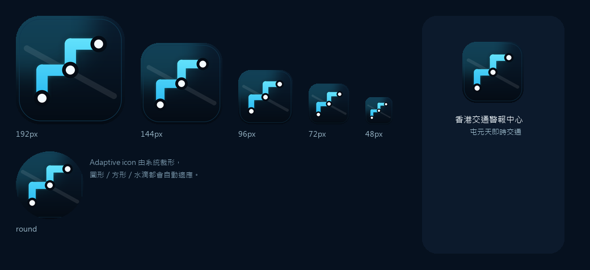
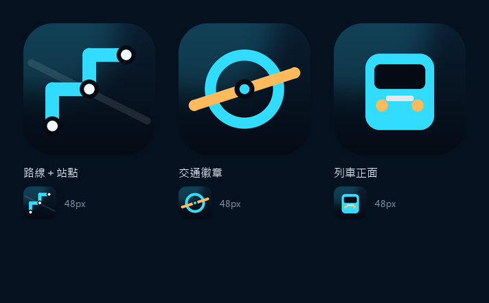

# Android App Icon — 香港交通警報中心

為 https://d-hkd.github.io/hk-traffic-super-screen/ 而設的 Android launcher icon。



## 設計：路線 ＋ 站點



| 元素 | 意思 |
|---|---|
| 青色圓頭折線 | 屯馬綫／輕鐵路網（三個轉角＝路線轉向） |
| 白色圓點＋深色外環 | 車站 |
| 背後淡白斜線 | 道路，暗示範圍不只鐵路 |
| 深藍底 `#0a1d30 → #040b14` | 網站 `--bg` / `--panel` |
| 左上青色光暈 | 頁首 radial-gradient |
| 內框 `#1b6d92` | 網站卡片邊線 |

配色取自網站 CSS 變數（`--cyan #32dcff`、`--cyan2 #11a9ee`），
所以 App 圖示與網頁是同一個視覺家族。

縮到 48px 仍見到「路線＋兩個站」，唔會糊成一團。

> 曾經試過四角星（網站 `.brand-mark` 的形狀），但使用者要求非星形，
> 最終採用路線＋站點。`concepts.png` 保留三個概念作記錄。

## 檔案

```
android-icons/
├── mipmap-mdpi/ic_launcher.png           48×48
├── mipmap-hdpi/ic_launcher.png           72×72
├── mipmap-xhdpi/ic_launcher.png          96×96
├── mipmap-xxhdpi/ic_launcher.png        144×144
├── mipmap-xxxhdpi/ic_launcher.png       192×192
├── mipmap-*/ic_launcher_round.png        圓形版本（同上各尺寸）
├── mipmap-anydpi-v26/ic_launcher.xml     Adaptive icon（連 monochrome）
├── mipmap-anydpi-v26/ic_launcher_round.xml
├── drawable/ic_launcher_foreground.png   432×432（前景，透明底）
├── drawable/ic_launcher_background.png   432×432（背景，滿版）
├── values/colors.xml                     背景色 #0A1D30
├── play-store-icon-512.png               512×512、無透明（Play Store 用）
└── preview.png                           各種尺寸對照
```

## 放入 Android Studio

1. 把 `mipmap-*`、`drawable`、`values`、`mipmap-anydpi-v26` 複製到
   `app/src/main/res/` 之下（同名資料夾合併）
2. `AndroidManifest.xml` 的 `<application>`：

```xml
android:icon="@mipmap/ic_launcher"
android:roundIcon="@mipmap/ic_launcher_round"
```

3. Adaptive icon 已預留安全區：前景圖案約佔 52%，系統用 66dp 安全區裁形時
   不會切到線頭或站點。圓形、方形、水滴形都會自動適應。
4. `monochrome` 指向同一前景，Android 13+ 主題圖示（Material You）可用。

## 重新生成

```bash
python tools/make-android-icons.py
```

改 `ROUTE`（路線轉角）、`STATIONS`（站點位置）、`CYAN` 等常數即可。
需要 Pillow。

只畫概念草圖：

```bash
python tools/icon-concepts.py     # 路線／徽章／列車 三個方向
```

## 如果要做成 APK

用 **TWA（Trusted Web Activity）** 包裝現有網站：

- `bubblewrap init --manifest https://d-hkd.github.io/hk-traffic-super-screen/manifest.webmanifest`
- 用本資料夾的 icon 覆蓋 `res/mipmap-*`
- 需要 `docs/.well-known/assetlinks.json`，否則網址欄會顯示